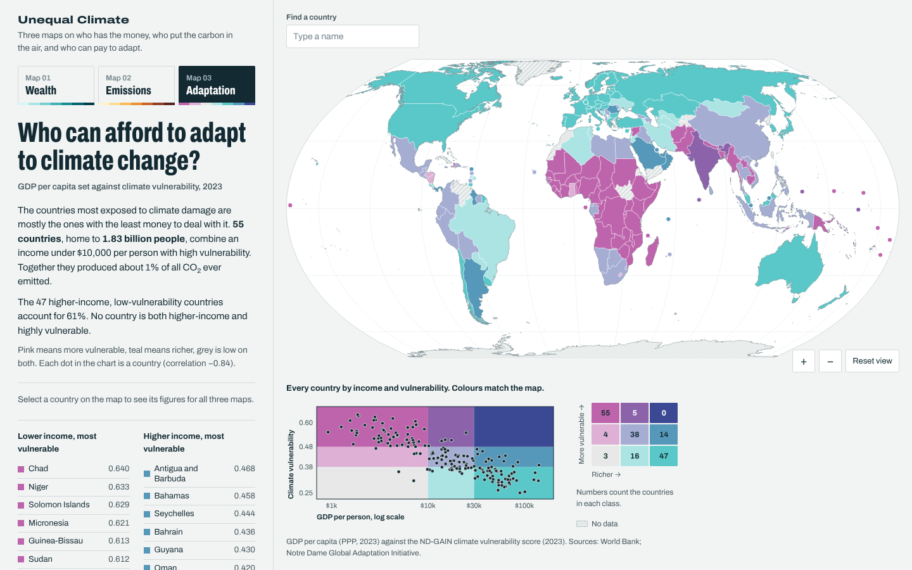

# Unequal Climate — три карты на одной странице

Интерактивный мини-геопортал: слева панель с описанием и переключателем карт, справа карта мира. Интерфейс на английском.

**Демо:** `https://<username>.github.io/<repo>/` — замените на свой адрес после публикации.



## Карты

| № | Вопрос | Что показано | Год |
|---|--------|--------------|-----|
| Map 01 | Who is rich and who is poor? | ВВП на душу населения по ППС, текущие международные доллары | 2023 |
| Map 02 | Who contributes most to climate change? | Выбросы CO₂ на душу населения: слой «Today» (за 2025 год) и слой «Since 1750» (накопленные выбросы на одного сегодняшнего жителя) | 2025 |
| Map 03 | Who can afford to adapt to climate change? | Бивариантная карта 3×3: ВВП на душу населения против индекса климатической уязвимости ND-GAIN, плюс диаграмма рассеяния по всем странам | 2023 |

## Что умеет страница

- Переключение карт вкладками (мышью или стрелками ← → на клавиатуре), у Map 02 — переключатель слоёв.
- Подсказка при наведении, выбор страны кликом: в панели появляется карточка с показателями сразу по трём картам.
- Поиск страны, масштабирование колесом и кнопками, сброс вида.
- Легенда-гистограмма: при наведении на класс подсвечиваются его страны на карте.
- Малые островные государства показаны кружками, чтобы их было видно в масштабе мира.
- Адрес запоминает состояние: `#wealth`, `#emissions`, `#emissions-since-1750`, `#adaptation`, а также выбранную страну, например `#adaptation/KAZ`.
- Адаптивная вёрстка: на телефоне карта располагается над текстом.

## Публикация на GitHub Pages

1. Создайте репозиторий и загрузите в него всё содержимое этой папки (включая файл `.nojekyll`).
2. Откройте **Settings → Pages**.
3. В блоке **Build and deployment** выберите **Deploy from a branch**, ветку `main` и папку `/ (root)`, нажмите **Save**.
4. Через одну-две минуты страница будет доступна по адресу `https://<username>.github.io/<repo>/`.

Сборка не нужна: это статические файлы, библиотеки и шрифт лежат в репозитории, внешних запросов страница не делает.

Локальный просмотр:

```bash
python3 -m http.server 8000
# затем открыть http://localhost:8000
```

Можно открыть `index.html` и двойным кликом, но тогда браузер может не подгрузить шрифт.

## Структура

```
index.html                разметка страницы
css/style.css             стили
js/app.js                 логика карт, легенд, панели
js/vendor/                D3 7 и topojson-client
data/countries.js         данные по странам (генерируется скриптом)
data/countries.csv        те же данные таблицей
data/world.js             границы стран (TopoJSON)
fonts/                    шрифт Archivo (variable)
scripts/build_data.py     сборка данных из исходных файлов
```

## Данные

| Показатель | Источник | Примечание |
|---|---|---|
| ВВП на душу населения, ППС | Всемирный банк, ряд «GDP per capita, PPP (current international $)» | Взят из выгрузки ND-GAIN (индикатор `gdp`), чтобы карты 01 и 03 опирались на одни и те же числа. Для Бутана, Ливана, Сан-Марино, Сирии и Тонги использовано значение 2022 года |
| Выбросы CO₂ | Global Carbon Budget (2026) через [Our World in Data](https://github.com/owid/co2-data) | Территориальные выбросы от ископаемого топлива и промышленности. Без землепользования, других парниковых газов и поправки на торговлю |
| Климатическая уязвимость | [ND-GAIN Country Index](https://gain.nd.edu/our-work/country-index/), Notre Dame Global Adaptation Initiative | Оценка vulnerability от 0 до 1, чем выше, тем уязвимее |
| Границы | Natural Earth 1:50m в сборке [visionscarto-world-atlas](https://github.com/Fil/visionscarto-world-atlas) | Проекция Equal Earth |

Поля `data/countries.csv`: `iso`, `name`, `region`, `subregion`, `pop` (население, 2025), `gdp_pc`, `gdp_year`, `co2_pc` (т на человека, 2025), `co2_cum_pc` (т на человека с 1750 года), `co2_cum_mt` (млн т), `co2_cum_share` (% мирового итога), `vuln`.

### Методические оговорки

- **Накопленные выбросы на душу** — это сумма выбросов страны с 1750 года, делённая на её население 2025 года. Показатель удобен для сравнения стран разного размера, но не описывает выбросы конкретных людей.
- **Классы Map 03** — округлённые терцили: 10 000 и 30 000 долларов для ВВП на душу, 0,38 и 0,48 для уязвимости. Подписи «lower / middle / higher income» не совпадают с группами стран по доходу Всемирного банка.
- **Связь дохода и уязвимости частично заложена в сам индекс:** в ND-GAIN входят показатели адаптивной способности, которые зависят от дохода. Карта показывает, где бедность и уязвимость совпадают, но не доказывает причинность.
- Доли групп стран по доходу в тексте Map 02 взяты из агрегатов Our World in Data (группы Всемирного банка).
- Заштрихованные территории — нет данных. Сомалиленд и Северный Кипр показаны со значениями Сомали и Кипра соответственно.

### Пересборка данных

```bash
python3 scripts/build_data.py owid-co2-data.csv path/to/nd-gain/resources countries.json
```

- `owid-co2-data.csv` — из репозитория [owid/co2-data](https://github.com/owid/co2-data);
- `resources/` — распакованный архив со [страницы загрузки ND-GAIN](https://gain.nd.edu/our-work/country-index/download-data/);
- `countries.json` — из [mledoze/countries](https://github.com/mledoze/countries) (нужны только названия регионов).

Годы задаются константами `CO2_YEAR` и `GAIN_YEAR` в начале скрипта.

## Благодарности и лицензии

- [D3](https://d3js.org) и [topojson-client](https://github.com/topojson/topojson-client) — ISC.
- Шрифт [Archivo](https://github.com/Omnibus-Type/Archivo) — SIL Open Font License.
- Бивариантная палитра 3×3 — по схеме Джошуа Стивенса (Joshua Stevens).
- Данные Our World in Data и Всемирного банка распространяются по лицензии CC BY 4.0; условия использования ND-GAIN указаны на сайте проекта. При повторном использовании ссылайтесь на первоисточники.
